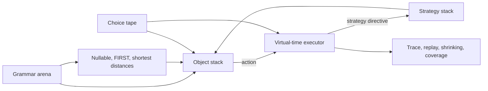

# Actgram

Write an action grammar once, then drive a system with seeded random or directed traversal and replay and shrink failures from the choice tape.

```rust
use actgram_engine::Eventually;
use actgram_exec::{run, Actions, Automaton, Limits, System};
use actgram_macros::grammar;
use actgram_trace::Trace;

struct Queue(Option<u8>);
impl System for Queue {}
fn main() {
    let g = grammar! { start test; test = alt(99 => seq(), 1 => pop); }.unwrap();
    let mut actions = Actions::new();
    actions.insert("pop", |ctx| Box::pin(async move {
        assert_eq!(ctx.with_system_mut(|q: &mut Queue| q.0.take()), Some(7));
        Ok(())
    }));
    let pop = g.action("pop").unwrap();
    let plan = [Automaton::new(&g, &actions).with_goal(Eventually(pop))];
    let trace = Trace::record(17, |c| run(Queue(Some(7)), &plan, Limits::default(), c));
    assert!(trace.execution.fault.is_none());
    println!("{:?}", trace.action_starts().collect::<Vec<_>>());
}
```

```text
[(0, "pop")]
```

Run it with `cargo run -p actgram-examples --example quickstart`. The first
number in the output identifies the automaton. The macro requires
`actgram-core` as a dependency in the calling crate. Use `Builder` for
grammars assembled at runtime.

## Replay and shrink a failure

Seed 17 in the built-in `long` scenario starts 500 actions and fails at
`check`. The reduction keeps the same assertion and reaches the shortest
word in this grammar.

```sh
cargo run -p actgram-cli -- run long --seed 17 --out failure.json
cargo run -p actgram-cli -- shrink failure.json --out small.json
cargo run -p actgram-cli -- replay small.json
cargo run -p actgram-cli -- coverage small.json
```

```text
500 → 2 actions
arm → check
check failed [demo]. the system is armed
```

The first command exits with status 1 after saving the failed run. Replay
exits successfully when it reproduces the saved execution. The CLI also
ships the `queue` and `wal` scenarios. Build with `--features seeded-bugs`
to run one of their mutations using `--bug`. Link the library crates into a
Rust test harness to drive your own system.

## Evidence

Each method ran 1,000 seeds per mutation against the same queue and
write-ahead-log workloads. `Eventually` improved detection for six
mutations and reduced it for four. A target reached along a common path
can leave the required setup unexplored.

| Method | Failures detected across ten mutations |
|---|---:|
| Actgram Random | 936 / 10,000 |
| Actgram Eventually | 6,400 / 10,000 |
| proptest-state-machine | 1,046 / 10,000 |

The report includes results for each mutation, conditional action counts,
and reduced reproduction lengths. [Evidence report](EVIDENCE.md).

## How it works



The builder validates symbol references, weighted alternatives and repeat
bounds. Fixed-point analysis computes which nodes can yield no actions,
which can start with a target, and the shortest action distance to each
reachable target. The engine expands the object stack under the top
strategy. `Next` requires a zero-action path to the target. `Eventually`
follows a shortest path, using expansion count to break ties and escape
nullable recursion. When a target is emitted, the strategy beneath it
resumes.

Register each `async fn(&mut Ctx<S>) -> ActionResult` with
`Actions::insert(name, |ctx| Box::pin(action(ctx)))`. The executor polls
one action per live automaton in seeded order each virtual tick.
`System::step` advances the system before the next tick, and
`ctx.wait_for` evaluates a condition through its virtual deadline.

## Choose the tool for the test

| Tool | Use it when |
|---|---|
| Actgram | The legal action sequences are worth sharing across scenarios and you can step the system deterministically. |
| [Proptest state machines](https://proptest-rs.github.io/proptest/proptest/state-machine.html) | A reference state and command preconditions express legal transitions or payload generation. |
| Grammar fuzzers | The input is a structured message or document and the main feedback comes from the parser or program under test. |
| Simulation frameworks | You need a timed model with explicit processes, event queues or domain-specific resources. |
| Portable Test and Stimulus | Your verification team uses the PSS model and toolchain to generate constrained scenarios for hardware and software targets. |

## Prior art

US7290193B2 describes weighted grammar traversal and switching traversal
strategies during system verification. The builder test implements its
Fig. 24 graph. Two companion patents cover verification resources and
synchronization. [US7290193B2](https://patents.google.com/patent/US7290193B2/en),
[US7234093B2](https://patents.google.com/patent/US7234093B2/en),
[US7234094B2](https://patents.google.com/patent/US7234094B2/en).

PSS defines portable constrained stimulus models. GraphWalker generates
test paths over graph models. Actgram evaluates whether nullable and FIRST
analysis can improve directed action coverage inside a deterministic
executor that also records choices for replay. [Accellera PSS](https://www.accellera.org/downloads/standards/portable-stimulus),
[GraphWalker](https://graphwalker.github.io/).

## Determinism and limits

- With the same grammar, initial state, strategy, limits and build, the seed
  reproduces the original trace. The engine uses pinned ChaCha8 and stable
  iteration order. A trace uses compact JSON for its SHA-256 hash.
- Keep action and system code deterministic. Polling supports Actgram waits
  and work that completes synchronously within a poll. Real I/O, wall time
  and operating-system scheduling belong in an integration test. A
  virtual deadline bounds cooperative waits. Computation that never yields
  requires an external process timeout.
- A saved tape reproduces the edited run after shrinking. Every edit is
  expanded by the grammar and rechecked against the same failure signature.
  A failure can stop at a legal prefix. Passing a full shrink pass means
  the tested edits have reached a local minimum. The 500-action fixture
  has a separately established global minimum of two.
- Expansion, action and tick limits bound every run. Directed guarantees
  assume those limits allow the required expansions and that each live
  action can return before the target is reached.

## Status and licence

Version 0.1.0 is a release candidate. The workspace supports Rust 1.88.0 and
later. CI checks golden trace hashes on Linux, macOS and Windows. Future
evidence can cover systems with larger state spaces and targets selected
without prior knowledge of the bug. [Release preparation](RELEASING.md).

Dual licensed under [MIT](LICENSE-MIT) or [Apache-2.0](LICENSE-APACHE).
